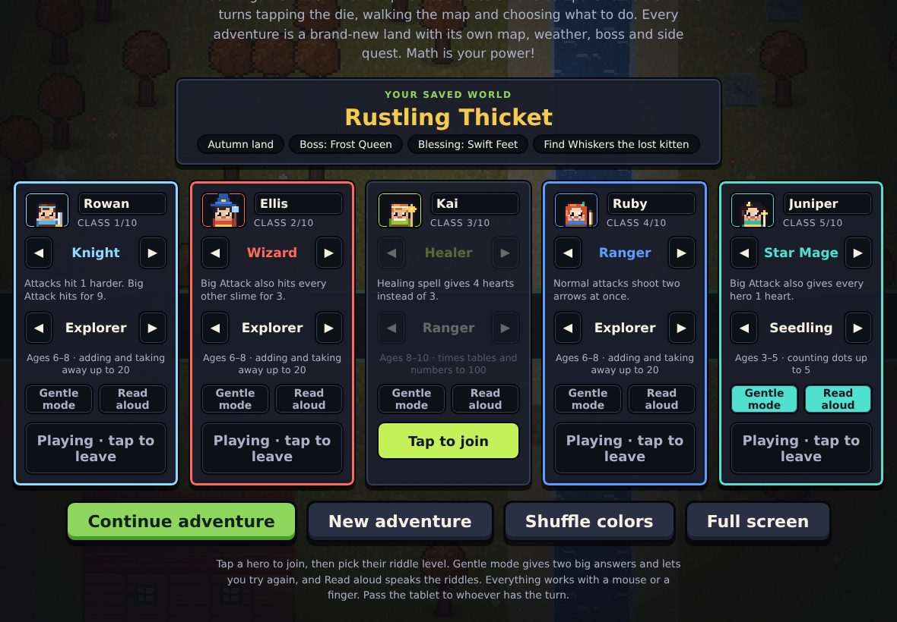
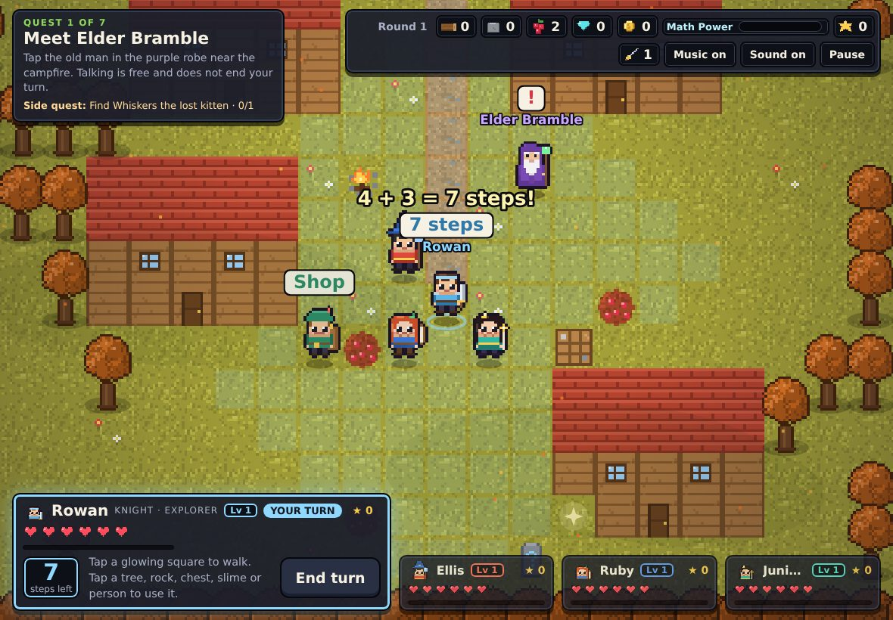
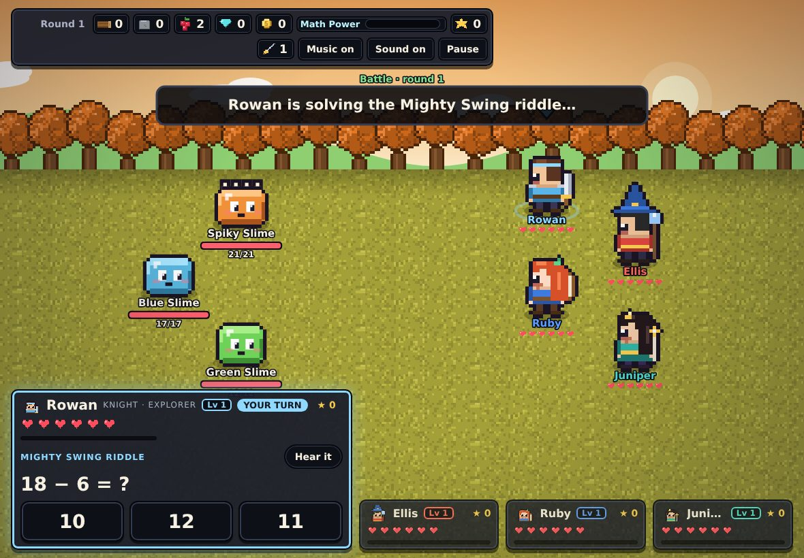

# Mossbrook Quest

A board-game RPG for up to five players sharing one tablet or computer, where **math is your power source**. Take turns rolling the die, explore a brand-new world every adventure, battle slimes, and power up your attacks, heals and the Team Super by solving riddles at your own level.

**Play it:** https://locher32-cmd.github.io/mossbrook-quest/



| Exploring the map | A battle riddle |
|---|---|
|  |  |

## How to play

1. On the title screen, tap each hero who is playing. Give them a name, a class and a riddle level.
2. Check the **Your next world** card, or tap **Roll a different world**, then tap **Start adventure**.
3. On your turn, tap **Roll the die**. The roll plus 2 is how many squares you can walk; the squares you can reach glow.
4. Tap a glowing square to walk there, or tap a tree, rock, berry bush, chest, the bridge or a person to walk over and use it. Using something ends your turn.
5. After every hero has gone, the slimes move. Touch a slime and the whole team fights it together.

Everything works by tap or click. Pass the tablet to whoever has the turn.

## Math is the power

Every riddle a hero answers right does something:

- **Big Attack** and **Heal** only work if you solve the riddle.
- **Combo**: riddles right in a row make Big Attacks stronger and earn bonus coins.
- **Math Power**: each right answer fills the team meter. When it's full, anyone can unleash a **Team Super** that blasts every slime and heals the team.
- Chests, Wise Stones and the boss's magic shield all open with riddles.
- Right answers also earn XP, which levels heroes up (more hearts, stronger hits).

Wrong answers show a short, step-by-step explanation (for example "Start at 7 and count on 5: 8, 9, 10, 11, 12").

| Level | Ages | Riddles |
|---|---|---|
| Seedling | 3–5 | Counting dots up to 5, picking the bigger number |
| Sprout | 4–6 | Counting and adding up to 10 |
| Explorer | 6–8 | Adding and taking away up to 20 |
| Ranger | 8–10 | Times tables, adding and taking away up to 100, dividing |
| Wizard | 10+ and grown-ups | Big multiplying, missing numbers, order of operations, halves |

Each hero picks their own level, so a five-year-old and a grown-up can play side by side.

## Every world is different

Each new adventure is generated from a random seed:

- **Map**: river and bridge, village and houses, forests, ponds, rocks, chests, Wise Stones and the boss cave all move.
- **Land**: Meadow, Autumn, Snowy or Desert, each with its own colours and weather.
- **Boss**: Slime King, Frost Queen, Lava Lord or Shadow Duke, each with its own battle trick.
- **Quest goals**: how much wood the bridge needs and how many slimes to bop.
- **Side quest**: golden apples, rainbow flowers, dragon eggs, or a lost kitten.
- **Blessing**: a random team bonus such as starting coins, extra hearts or Speedy boots.

A saved adventure keeps its world. Starting a new one always takes you somewhere new.

## Classes

| Class | Special |
|---|---|
| Knight | Attacks hit 1 harder; Mighty Swing hits for 9 |
| Wizard | Star Storm also hits every other slime for 3 |
| Healer | Healing spell gives 4 hearts instead of 3 |
| Ranger | Normal attacks shoot two arrows |
| Star Mage | Moonbeam also gives every hero a heart |
| Ninja | Dodges 1 in 3 slime attacks; Shadow Strike hits twice |
| Paladin | Defend protects the whole team |
| Druid | Vine Wrap ties up a slime so it skips a turn |
| Bard | Lullaby hits every slime and puts them to sleep |
| Barbarian | Attacks hit 2 harder; Rage Smash hits for 10 |

## For little players

Each hero has two switches on the title screen:

- **Gentle mode**: two big answer buttons, and a wrong tap just says "Try again" with a hint, so the turn is never lost.
- **Read aloud**: turn prompts and riddles are spoken using the device's built-in voice. A **Hear it** button repeats any riddle.

The game also respects the device's "reduce motion" setting.

## Install on an iPad

1. Open https://locher32-cmd.github.io/mossbrook-quest/ in Safari or Chrome.
2. Tap the Share button, then **Add to Home Screen**.
3. Open it from the home screen. It runs full screen and keeps working without internet after the first visit.

## Saving and privacy

- Progress, hero names, classes and settings are saved **only on the device**, in the browser's local storage. Nothing is sent anywhere.
- The only things loaded from the internet are this page and two Google Fonts (the game falls back to built-in fonts without them).
- There are no accounts, ads, analytics or in-app purchases. The coins in Pip's Shop are game coins.

## Run it yourself

It's a single HTML file with no build step and no dependencies.

```bash
git clone https://github.com/locher32-cmd/mossbrook-quest.git
cd mossbrook-quest
python3 -m http.server 8000
# open http://localhost:8000
```

Opening `index.html` directly also works; offline install support needs it to be served over http(s).

## Project layout

```
index.html             the whole game: HTML, CSS and JavaScript
manifest.webmanifest   lets the game install to a home screen
sw.js                  offline support (keeps a copy of the game on the device)
icons/                 app icons
docs/                  screenshots for this README
```

All art is drawn in code as pixel art, and the music and sound effects are generated with the Web Audio API, so there are no image or audio files to load.

When you change `index.html`, bump `CACHE` in `sw.js` (for example `mossbrook-v2`) so installed copies pick up the update.

## License

[MIT](LICENSE)
